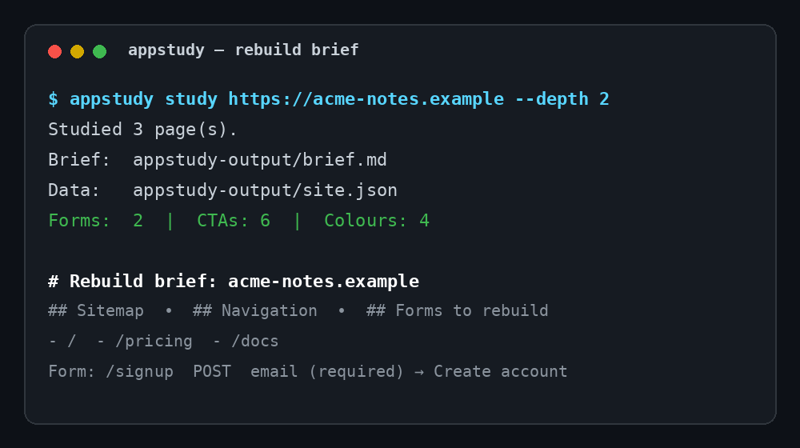

<div align="center">

# appstudy

**Study how any website works from its public surface — then rebuild it yourself.**

Clean-room site analysis: pages, navigation, forms, calls to action, and design
tokens, turned into a rebuild brief. No copied code. No logins. No dependencies.



[](https://www.python.org/)
[](#)
[](LICENSE)
[](https://github.com/BidyutRoy2/appstudy/actions/workflows/ci.yml)

</div>

---

## Why appstudy?

The fastest-growing repos on GitHub this week are tools that **study how an app
works and rebuild it** — but most of them need a heavy agent harness, an API
key, or a whole Rust toolchain. `appstudy` is the small, honest version:

| | appstudy | Heavy agent rebuild tools |
|---|---|---|
| Install | One Python file tree, zero deps | Toolchain + API keys + agent setup |
| What it reads | Only the public, visible surface | Full app internals, often via agents |
| Output | A rebuild brief a human *or* an agent can build from | A generated project you must untangle |
| Works offline | Yes — point it at a folder of saved HTML | Usually no |
| Copies code? | **Never** — description only, clean-room by design | Sometimes, by accident |

## Quickstart

```bash
git clone https://github.com/BidyutRoy2/appstudy.git
cd appstudy
python3 -m appstudy study https://example.com --depth 2 --out appstudy-output
```

That writes two files:

- `appstudy-output/brief.md` — the human-readable rebuild brief
- `appstudy-output/site.json` — the same data, machine-readable

No package is published yet, so there is no `pip install appstudy` line —
source install above is the real install. (A PyPI release is planned; see
[CHANGELOG.md](CHANGELOG.md).)

### Study a folder you already have

```bash
python3 -m appstudy study ./my-saved-site --local --out appstudy-output
```

### Options

| Flag | Default | What it does |
|---|---|---|
| `--depth` | `2` | How many link hops from the start page to follow |
| `--max-pages` | `50` | Page budget for one study |
| `--delay` | `0.3` | Seconds between requests (be polite) |
| `--out` | `appstudy-output` | Where `brief.md` and `site.json` go |

## What a brief contains

- **Sitemap** — every same-origin page found, as routes
- **Page inventory** — title, heuristic type (landing / pricing / docs / blog…),
  headings, image count
- **Navigation** — the links that repeat across pages, most frequent first
- **Design tokens (observed)** — colours and font stacks actually declared
- **Calls to action** — every button label, ranked by frequency
- **Forms to rebuild** — action, method, and every field with its label and
  required flag
- **What to build first** — a suggested build order, landing page first

See a real one: [examples/sample-brief.md](examples/sample-brief.md), generated
from the three-page fixture site in [examples/sample-site/](examples/sample-site/).

## The clean-room rules

These are enforced by design, not by policy text:

1. **Same origin only.** Links to other domains are recorded as outbound, never crawled.
2. **Visible surface only.** Titles, headings, nav, forms, buttons, colours,
   fonts — nothing else is collected. No scripts, no source, no assets.
3. **No logins, ever.** The crawler sends no cookies and no credentials; anything
   behind auth simply is not studied.
4. **Polite by default.** A delay between requests and a page budget on every run.

If a site's `robots.txt` disallows crawling, respect it — this tool is for
studying public work and learning from it, not for scraping against a site's wishes.

## Use it with your coding agent

Feed `brief.md` to any coding agent as the spec:

> "Build this app from the attached rebuild brief. Use your own code and your
> own design decisions; the brief describes behaviour and structure, not
> implementation."

That keeps the rebuild original even when the inspiration is specific.

## FAQ

**Is this a website copier?**
No. It never downloads code, stylesheets, images, or assets. It writes a
*description* of what a visitor sees. Rebuilding from a description is how
clean-room engineering has always worked.

**Does it work on JavaScript-heavy sites?**
It reads the HTML the server returns. Pages that render everything client-side
will show a thin brief — that limitation is honest and documented in
[docs/limitations.md](docs/limitations.md).

**Can it study my own site before a redesign?**
Yes — that is one of the best uses. Run it on your staging site and hand the
brief to whoever does the redesign.

**Why Python with zero dependencies?**
So it runs anywhere Python exists, installs in seconds, and has no supply-chain
surface to audit. See [docs/architecture.md](docs/architecture.md).

## Development

```bash
python3 -m unittest discover -s tests -v   # 13 tests, stdlib only
```

Contributions welcome — see [CONTRIBUTING.md](CONTRIBUTING.md).

## License

MIT — see [LICENSE](LICENSE).
